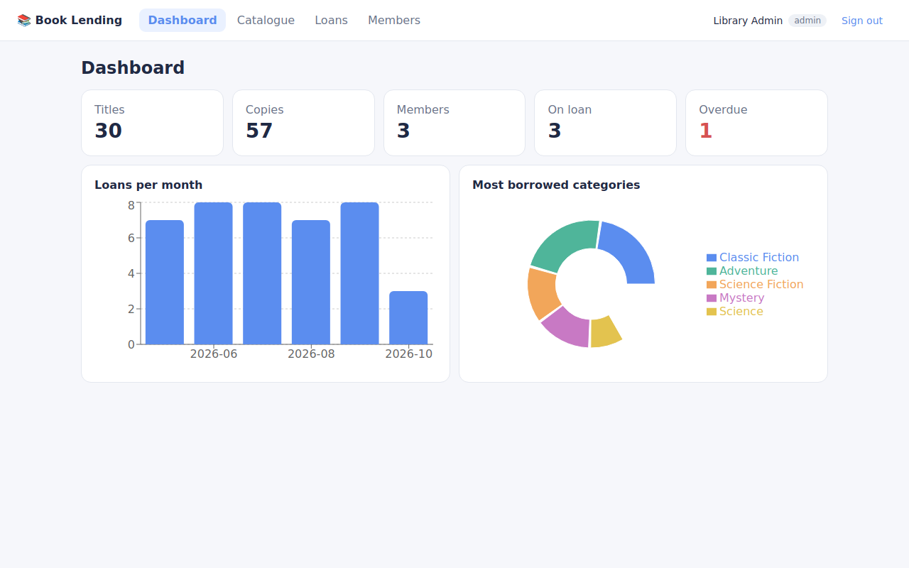
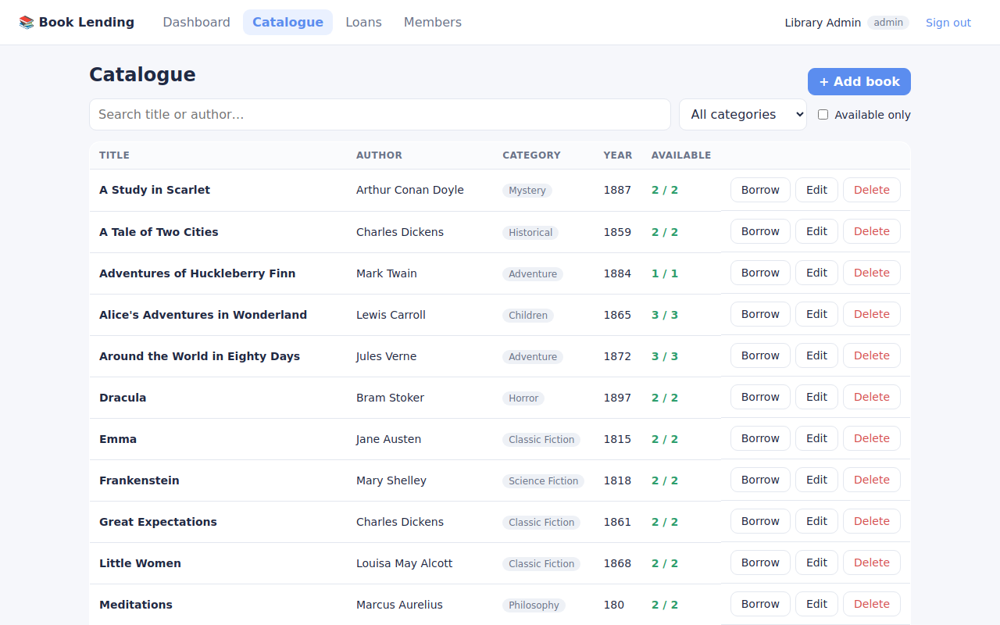
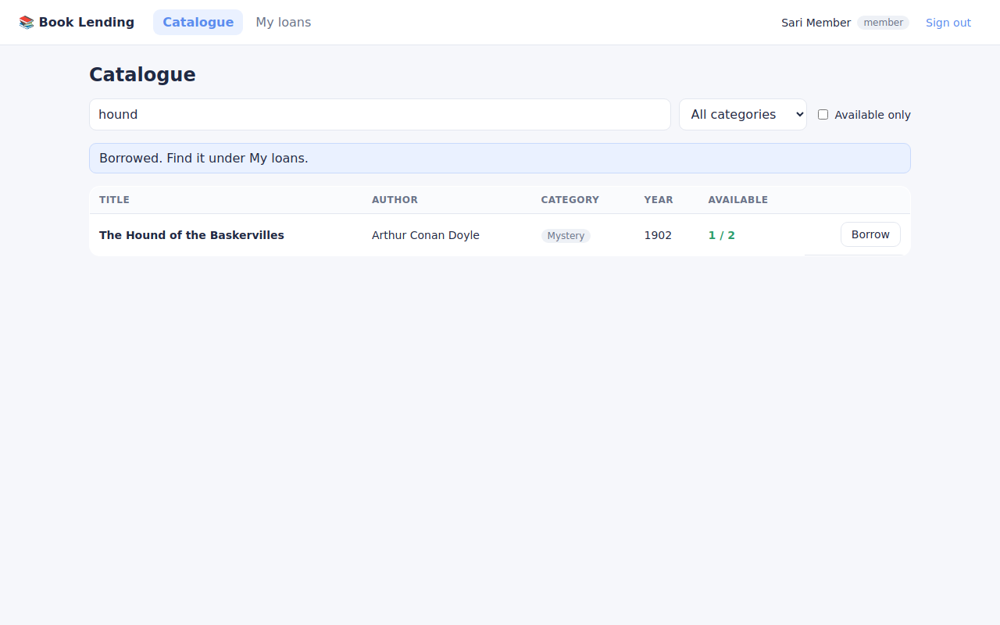
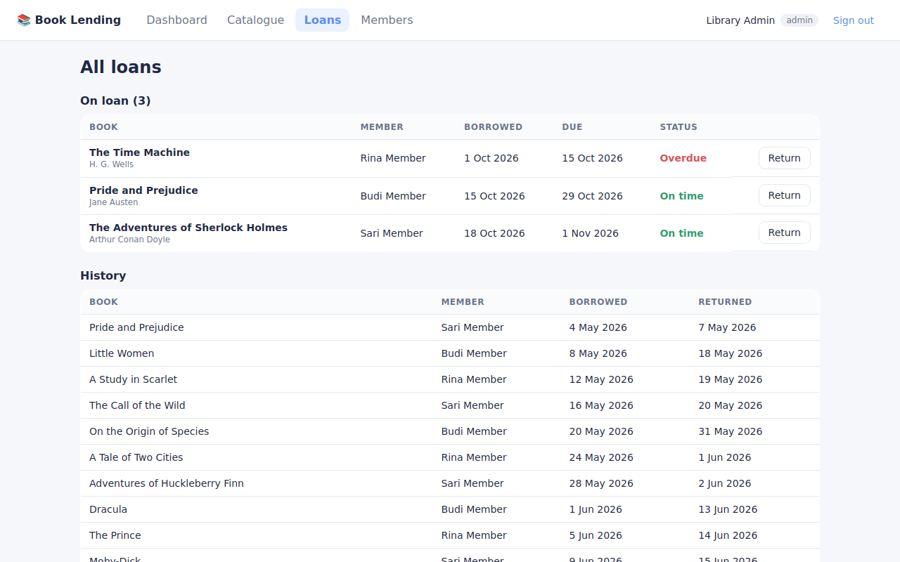
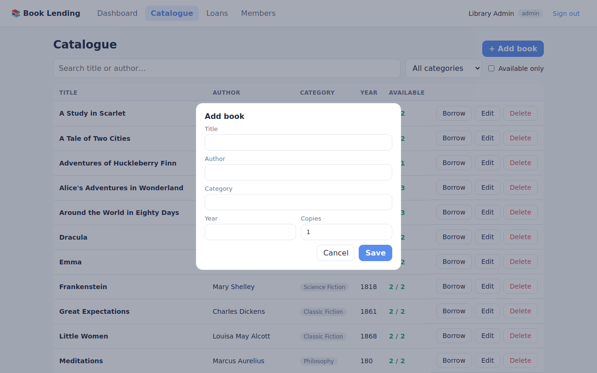

# 📚 Book Lending App

A small, complete library system: browse a catalogue, borrow and return books, and see what is happening on an admin dashboard.

Built as a full-stack TypeScript project: **React** on the front end, an **Express REST API** on the back end, **SQLite** for storage, with tests, CI and a one-command Docker setup.



## Features

- **Sign-in with roles**: admins manage the catalogue and see everything; members borrow and return their own books
- **Catalogue**: search by title or author, filter by category, show available copies only
- **Lending rules** enforced on the server: stock per title, max 3 open loans per member, no duplicate loans, 14-day due date, overdue tracking
- **Admin dashboard**: totals, overdue count, loans per month and most borrowed categories
- **Book management**: add, edit and delete books with validation (you cannot delete a book that is on loan, or cut copies below what is lent out)

| Catalogue | Borrowing as a member |
|---|---|
|  |  |
| **Loans** | **Add book** |
|  |  |

## Tech stack

| Layer | Tools |
|---|---|
| Front end | React 18, TypeScript, Vite, TanStack Query, React Router, Recharts |
| Back end | Node.js, Express, TypeScript, Zod validation, JWT in an httpOnly cookie, bcrypt, Helmet |
| Database | SQLite (better-sqlite3) with transactions for borrowing |
| Quality | Vitest + Supertest API tests, strict TypeScript, GitHub Actions CI |
| Delivery | Multi-stage Dockerfile, docker compose |

## Run it

**With Docker** (easiest):

```bash
docker compose up --build
```

Open http://localhost:3000. Demo data is created on first start.

**Locally** (Node.js 22):

```bash
npm install
npm run seed     # creates server/data/library.db with demo data
npm run dev      # API on :3000, React app on http://localhost:5173
```

### Demo accounts

| Role | Email | Password |
|---|---|---|
| Admin | `admin@demo.local` | `demo1234` |
| Member | `sari@demo.local` | `demo1234` |

## API

All endpoints are under `/api` and return JSON. Errors look like `{ "error": "message" }`.

| Method | Endpoint | Who | Description |
|---|---|---|---|
| POST | `/auth/login` | anyone | Sign in, sets the session cookie |
| POST | `/auth/logout` | signed in | Sign out |
| GET | `/auth/me` | signed in | Current user |
| GET | `/books?q=&category=&available=1` | signed in | Search the catalogue |
| GET | `/books/categories` | signed in | Category list |
| POST / PUT / DELETE | `/books`, `/books/:id` | admin | Manage books |
| GET | `/loans` | signed in | Own loans (admins: all loans) |
| POST | `/loans` | signed in | Borrow `{ bookId }` |
| POST | `/loans/:id/return` | owner or admin | Return a book |
| GET | `/stats` | admin | Dashboard numbers |
| GET | `/users` | admin | Member list |

## Project structure

```
server/   Express API (src/app.ts routes, src/db.ts schema, src/seed.ts demo data, src/app.test.ts tests)
client/   React app (src/pages, src/components, src/lib/api.ts typed API client)
```

## Tests

```bash
npm test
```

The API tests cover sign-in, permissions, validation, stock and loan limits, returns and the dashboard numbers.

## Notes

- The demo books are public-domain classics, so the sample data is free to share.
- For a real deployment, set a long random `JWT_SECRET`, serve over HTTPS and remove `INSECURE_COOKIE`.

## License

MIT
